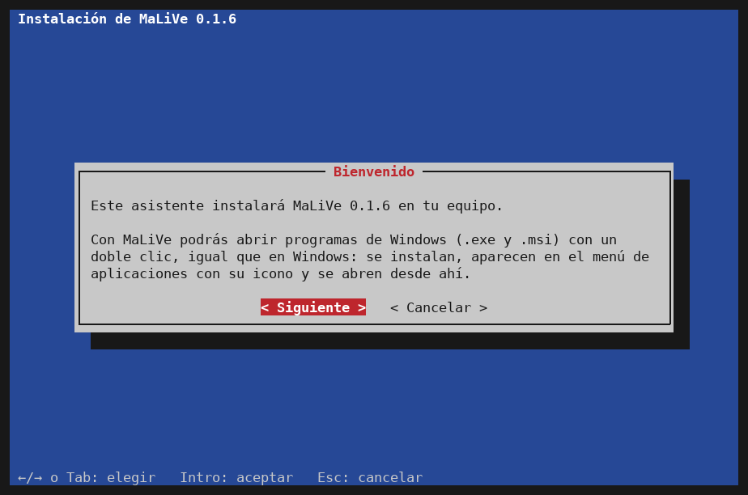
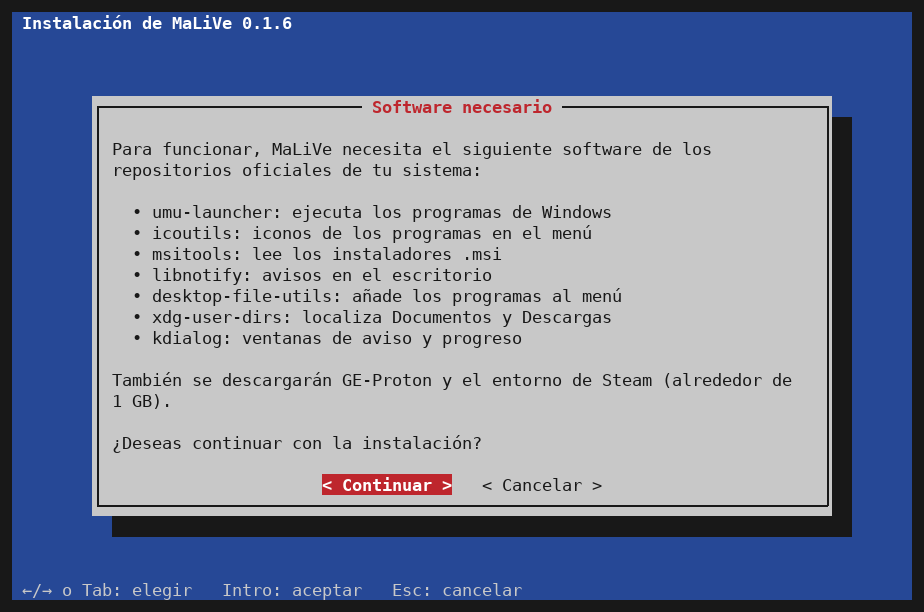
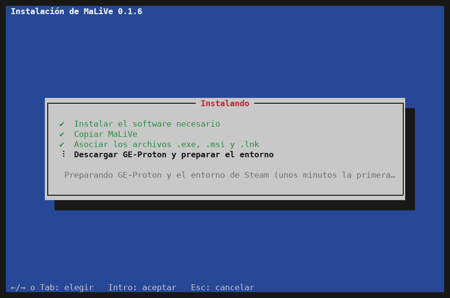
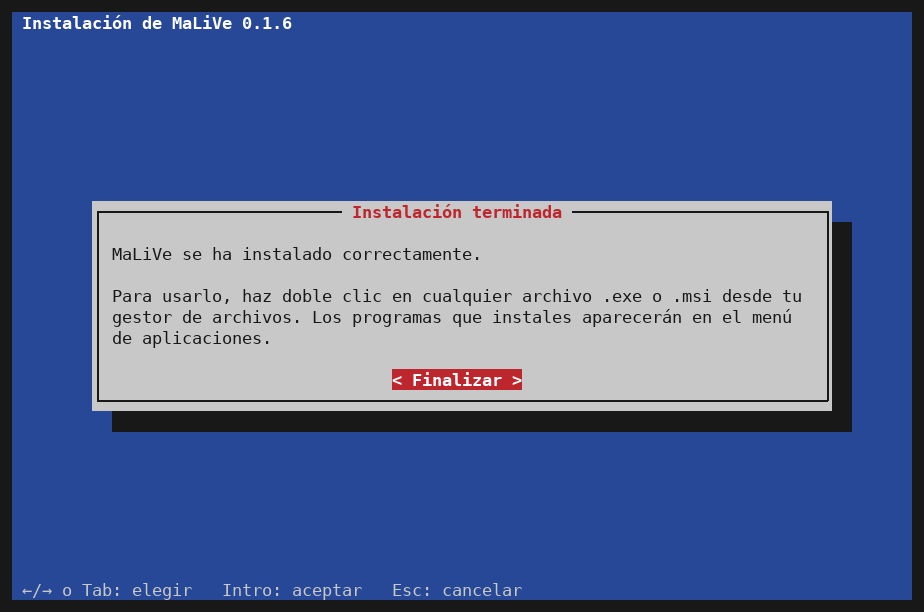

# MaLiVe — Make Linux Versatil

[English](README.md) · **Español**

Doble clic en un `.exe` o `.msi` desde el gestor de archivos y se ejecuta o se
instala, como en Windows. Por debajo: **umu-launcher + GE-Proton**, un prefijo
por app y accesos en el menú de aplicaciones con su icono.

[](https://github.com/Mortinner/MaLiVe/releases/latest)
[](https://github.com/Mortinner/MaLiVe/actions/workflows/ci.yml)
· Licencia GPL-3.0

MaLiVe habla **español e inglés**: el asistente, los diálogos, los avisos y
los comandos salen en español si tu sistema está en español, y en inglés en
otro caso.

## Instalación

1. Descarga `malive-X.Y.Z.zip` de la [última versión](https://github.com/Mortinner/MaLiVe/releases/latest)
   y descomprímelo (clic derecho → Extraer aquí).
2. Entra en la carpeta `malive-X.Y.Z` y haz doble clic en `install.sh` → **Ejecutar**
   (o en una terminal: `./install.sh`).

Se abre un asistente con ventanas en la terminal (estilo instalador clásico
de Linux; se maneja con ←/→, Intro y Esc): bienvenida, software necesario
("¿Deseas continuar con la instalación?"), contraseña si hace falta instalar
paquetes, progreso y final. Si se cancela, no se toca nada. El asistente
sale en español si tu sistema está en español, y en inglés en otro caso.

<table>
  <tr>
    <td></td>
    <td></td>
  </tr>
  <tr>
    <td></td>
    <td></td>
  </tr>
</table>

- Si se lanza sin terminal (doble clic → Ejecutar), se vuelve a abrir solo en
  la terminal del escritorio (Konsole, Ptyxis/GNOME Console, GNOME Terminal…).
- La contraseña se pide en su propia ventana y se pasa a `sudo`; nunca se
  guarda. Si no hay `sudo`, se usa `pkexec` (ventana del sistema).
- Registro de la instalación: `~/.local/state/malive/install.log`.
- `./install.sh --yes`: sin ventanas ni preguntas (instalación desatendida).
- Necesita una distro basada en Arch (CachyOS, Arch, EndeavourOS, Manjaro) con
  el repositorio `[multilib]` activo (ahí está `umu-launcher`); si no lo está,
  el asistente explica cómo activarlo.
- Después, MaLiVe **se actualiza solo** (ver más abajo). También puedes
  actualizar a mano ejecutando el `install.sh` de la versión nueva, sin
  desinstalar: conserva tus programas, sus datos y GE-Proton.

Desinstalar: `./uninstall.sh` (conserva tus apps) o `./uninstall.sh --purge`
(lo borra todo). Los paquetes del sistema no se desinstalan, porque otros
programas pueden usarlos.

## Qué hace al hacer doble clic

| Fichero | Qué pasa |
|---|---|
| Instalador (NSIS, Inno Setup, InstallShield, WiX Burn, 7z SFX…, o con nombre tipo `setup.exe`) | Crea un prefijo para la app (o reutiliza el de la misma app si ya existe), lo instala y crea los `.desktop` a partir de los `.lnk` que deja el instalador |
| `.msi` | Igual, con `msiexec /i … DISABLEADVTSHORTCUTS=1` (para que los accesos apunten al `.exe` real) |
| `.exe` normal fuera de un prefijo | Programa portable: un prefijo por carpeta, que se reutiliza la próxima vez |
| `.exe` o `.lnk` dentro de un prefijo de MaLiVe | Lo ejecuta en ese prefijo |
| Programa de consola | Lo abre con `start /wait /unix …` para que tenga ventana de consola |
| Programa de MS-DOS / 16 bits, `.dll` | Aviso explicando que no se puede |

GE-Proton y el runtime ya se descargan durante la instalación. Al crear el
primer entorno de cada app se ve un diálogo "Preparando…".

Si el instalador no crea accesos directos, MaLiVe busca los `.exe` nuevos y,
si hay varios, pregunta cuáles poner en el menú. Si no se instaló nada
(instalador cancelado) y el prefijo era nuevo, lo borra.

Cada acceso del menú tiene la acción **Desinstalar** en su clic derecho, que
borra el programa junto con su prefijo.

Los programas instalados también salen en **Abrir con** del gestor de archivos
para los tipos de fichero que su instalador registró en Windows (se leen del
registro del prefijo), y aceptan ficheros arrastrados a su icono. Las rutas de
Linux se traducen a las de Windows (`~/Documentos/notas.txt` → `D:\notas.txt`).

**Complementos** (códecs, plugins, bibliotecas): un instalador como el de LAV
Filters no es un programa nuevo, sino algo para otro programa. MaLiVe
reconoce los más comunes (LAV Filters, K-Lite, Visual C++, .NET, DirectX…) y
los instala dentro del programa que corresponde:
- si solo uno de los candidatos está abierto (para códecs, los que abren
  vídeo o audio), va a ese sin preguntar; si no hay ninguno abierto y solo
  tienes un reproductor, también;
- si hay varios, pregunta con casillas (se puede elegir más de uno), con el
  último usado marcado.

Con un instalador desconocido MaLiVe no adivina: es un programa nuevo, salvo
que haya algún programa de MaLiVe abierto, en cuyo caso pregunta por si es un
complemento suyo. Para forzarlo: clic derecho → **Abrir con → MaLiVe:
instalar dentro de un programa…**, o `malive-run --into APP fichero.exe`.

## Actualizaciones automáticas

Un temporizador de systemd de usuario (`malive-auto.timer`) busca cada 3 horas
una versión nueva en las [releases de GitHub](https://github.com/Mortinner/MaLiVe/releases)
(una consulta pequeña cada vez, muy por debajo de los límites de GitHub):

1. Descarga el zip y comprueba su SHA-256.
2. Si la versión nueva necesita software del sistema que no tienes, avisa con
   una notificación y ofrece abrir el asistente (hace falta tu contraseña).
3. Si no, la instala en segundo plano, comprueba que arranca y, si algo
   falla, vuelve a la versión anterior. Al terminar avisa: «MaLiVe se ha
   actualizado a la versión X».

Una vez por semana descarga también el último GE-Proton, que solo se usa
para los programas nuevos.

```
malive update            actualizar ahora
malive update --check    solo comprobar
malive set auto-update off|on
```

## Decisiones de diseño implementadas

- **Proton fijado por app.** Cada app guarda la versión de GE-Proton con la
  que se creó y siempre arranca con esa. Las versiones nuevas solo se usan para
  apps nuevas; para migrar una app: `malive proton use APP GE-ProtonX-Y`.
  Los Proton viven en `~/.local/share/malive/proton` (ni Steam ni umu los
  borran). Si falta la versión fijada, se vuelve a descargar.
- **Aislamiento (activado por defecto).** Proton recrea `Z: → /` en cada
  arranque si no existe, así que en vez de borrarla MaLiVe la apunta a una
  carpeta vacía. Se comparten Documentos (D:) y Descargas (E:), y la carpeta
  del instalador/portable como Y: si no está ya dentro de esas.
  Los **discos de datos y carpetas de red** del equipo (un NAS por CIFS/NFS, un
  segundo disco, un USB en `/run/media`) reciben letra fija, empezando por M:
  y N:, que se recuerda aunque el disco no esté conectado. Se excluye todo lo
  del sistema (raíz, `/boot`, `/var`, subvolúmenes del disco del sistema…).
  Desactivar: `malive set host-drives off`.
  Desactivar: `malive set isolate off` (global) o `--app ID`.
- **Fin de instalación:** se escanean los accesos al terminar el instalador y
  otra vez cuando ya no queda ningún proceso del prefijo (bootstrappers que se
  relanzan, o la app que el instalador abre al acabar).
- Si el prefijo ya tiene algo en marcha, se lanza con el verbo `run` de Proton
  (en vez de `waitforexitandrun`) para no esperar a que se cierre lo otro.

## Comandos

```
malive list [--size]            apps instaladas
malive remove APP [-y]          borrar app, prefijo y accesos
malive shortcuts APP [--all]    volver a buscar accesos (--all: elegir entre todos los .exe)
malive exec APP winecfg         winecfg, regedit, cmd, un .exe… dentro del prefijo
malive winetricks APP dotnet48  componentes extra
malive proton list|update|use
malive update [--check]         actualizar MaLiVe
malive set isolate on|off [--app APP]
malive set host-drives on|off   discos de datos y NAS como unidades (M:, N:…)
malive doctor                   comprobar dependencias e integración
malive setup                    descargar GE-Proton y runtime y probar que Proton arranca
malive integrate | unintegrate
```

## Dónde está cada cosa

| | |
|---|---|
| Prefijos | `~/.local/share/malive/prefixes/<app>/` |
| GE-Proton | `~/.local/share/malive/proton/` |
| Apps registradas | `~/.config/malive/apps/<app>.json` |
| Configuración | `~/.config/malive/config.json` (`isolate`, `shared_folders`, `auto_update`, …) |
| Registro de MaLiVe | `~/.local/state/malive/malive.log` |
| Salida de umu/Proton por app | `~/.local/state/malive/logs/<app>.log` |
| Accesos del menú | `~/.local/share/applications/malive-<app>-<entrada>.desktop` |

## Limitaciones conocidas

- **El aislamiento es parcial.** Quitar Z: evita que el programa vea `/` por
  sus unidades, pero Wine aún puede abrir rutas `\\?\unix\…`, y el contenedor
  de umu (pressure-vessel) comparte tu home. Es una mitigación, no un sandbox.
- Sin `binfmt_misc` todavía (ejecutar `.exe` desde la terminal: usa `malive run`).
- Un portable con nombre de instalador (p. ej. `setup-tool.exe` sin firma de
  instalador) se trata como instalador; si no instala nada, su prefijo se borra.
- La sección del menú se deduce de los tipos de fichero que abre el programa
  (vídeo/audio → Multimedia, imágenes → Gráficos…); si no registra ninguno, va
  a Utilidades.
- Los menús contextuales que un programa añade al Explorador de Windows (p. ej.
  el submenú de 7-Zip) no aparecen en Dolphin: son DLL que solo el Explorador
  puede cargar.
- Fuera de alcance: antitrampas de kernel, drivers, DRM agresivo.

## Publicar una versión

1. Sube la versión en `malive/__init__.py` y `release.json`, y añade su
   sección en `CHANGELOG.md` (`## X.Y.Z`).
2. Si la versión necesita paquetes nuevos del sistema, añádelos a
   `release.json` **y** a `install.sh` (un test comprueba que coinciden).
3. `git commit` y `git push` a `main`.

Cuando cambia `release.json` en `main`, GitHub Actions crea la etiqueta
`vX.Y.Z`, pasa los tests, crea `malive-X.Y.Z.zip` con su `.sha256` y
publica la release con las notas del CHANGELOG. Los equipos con MaLiVe se
actualizan solos en unas 3 horas como mucho.

## Desarrollo

```fish
python -m venv .venv; and .venv/bin/pip install pytest pylnk3
.venv/bin/python -m pytest -q
```

Los tests usan un `umu-run` falso (`tests/fake_umu_run.py`) que imita la
estructura de prefijo de umu/Proton, y binarios reales de prueba en
`tests/fixtures` (PE con mingw, instalador NSIS con makensis, MSI con wixl;
fuentes incluidas). Para ejecutar desde el repo sin instalar: `bin/malive`,
`bin/malive-run`.
