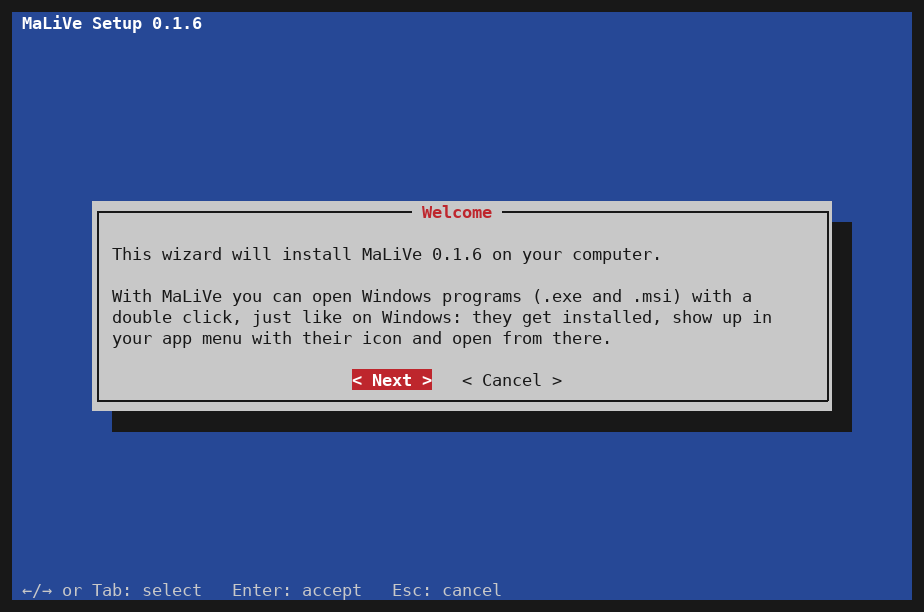
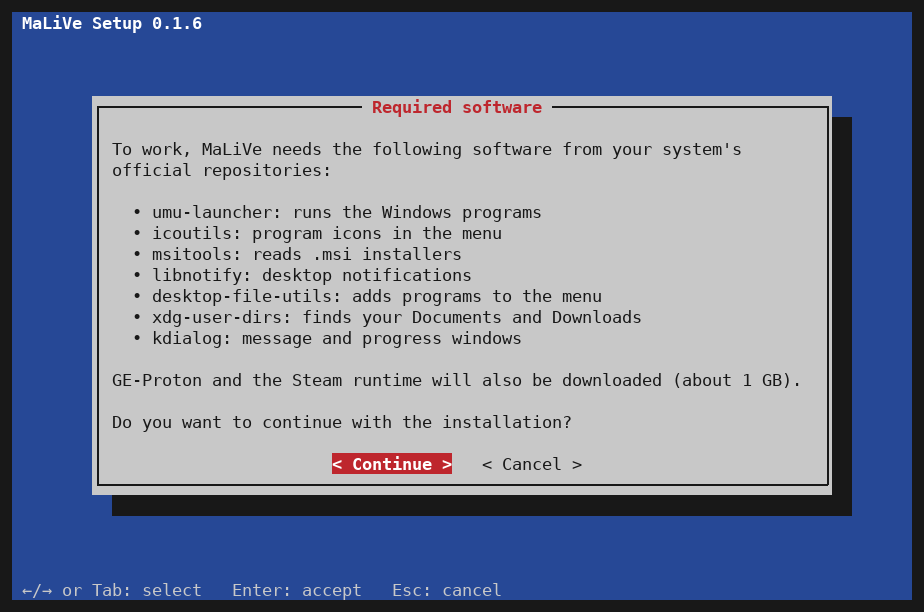
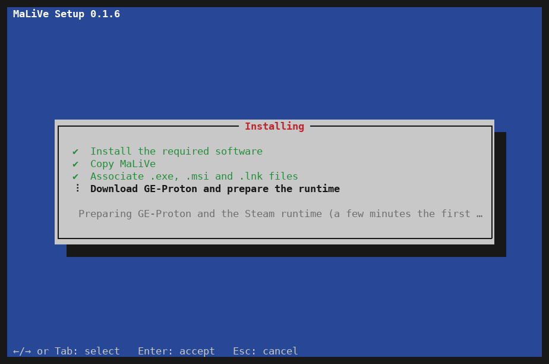
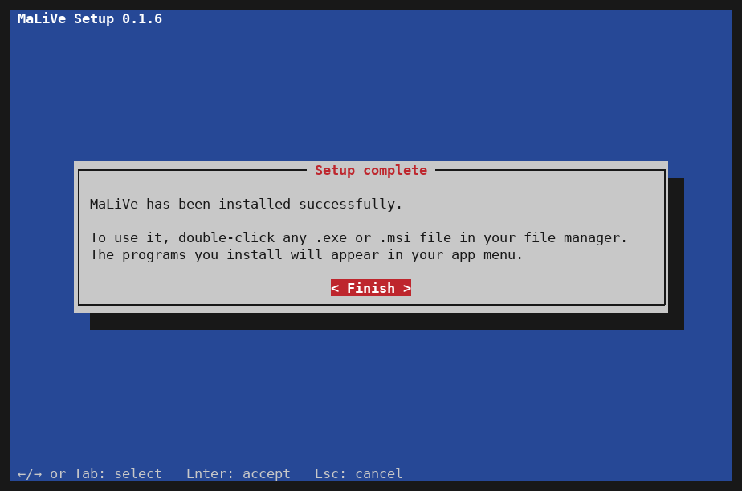

# MaLiVe — Make Linux Versatil

**English** · [Español](README.es.md)

Double-click a `.exe` or `.msi` in your file manager and it runs or installs,
just like on Windows. Under the hood: **umu-launcher + GE-Proton**, one prefix
per app, and app-menu entries with the program's own icon.

[](https://github.com/Mortinner/MaLiVe/releases/latest)
[](https://github.com/Mortinner/MaLiVe/actions/workflows/ci.yml)
· License GPL-3.0

MaLiVe speaks **English and Spanish**: the installer, dialogs, notifications
and commands use Spanish if your system is in Spanish, and English otherwise.

## Installation

1. Download `malive-X.Y.Z.zip` from the [latest release](https://github.com/Mortinner/MaLiVe/releases/latest)
   and extract it (right click → Extract here).
2. Open the `malive-X.Y.Z` folder and double-click `install.sh` → **Run**
   (or, in a terminal: `./install.sh`).

A terminal-based setup wizard opens (classic Linux installer look; use ←/→,
Enter and Esc): welcome, required software, your password if packages need
installing, progress, done. Cancelling changes nothing. The wizard speaks
Spanish if your system is in Spanish and English otherwise.

<table>
  <tr>
    <td></td>
    <td></td>
  </tr>
  <tr>
    <td></td>
    <td></td>
  </tr>
</table>

- If launched without a terminal (double-click → Run), it reopens itself in
  your desktop's terminal (Konsole, Ptyxis/GNOME Console, GNOME Terminal…).
- The password is asked in its own window and passed to `sudo`; it is never
  stored. Without `sudo`, `pkexec` is used (system password dialog).
- Install log: `~/.local/state/malive/install.log`.
- `./install.sh --yes`: no windows, no questions (unattended install).
- Requires an Arch-based distro (CachyOS, Arch, EndeavourOS, Manjaro) with the
  `[multilib]` repository enabled (that is where `umu-launcher` lives); if it
  is disabled, the wizard explains how to enable it.
- From then on MaLiVe **updates itself** (see below). You can also update by
  hand by running the new version's `install.sh` without uninstalling: your
  apps, their data and GE-Proton are kept.

Uninstall: `./uninstall.sh` (keeps your apps) or `./uninstall.sh --purge`
(removes everything). System packages are left installed, since other
programs may use them.

## What happens on double-click

| File | What happens |
|---|---|
| Installer (NSIS, Inno Setup, InstallShield, WiX Burn, 7z SFX…, or named like `setup.exe`) | Creates a prefix for the app (or reuses the same app's prefix if it exists), runs the installer and creates `.desktop` entries from the `.lnk` shortcuts the installer leaves |
| `.msi` | Same, using `msiexec /i … DISABLEADVTSHORTCUTS=1` (so shortcuts point to the real `.exe`) |
| Plain `.exe` outside a prefix | Portable program: one prefix per folder, reused next time |
| `.exe` or `.lnk` inside a MaLiVe prefix | Runs it in that prefix |
| Console program | Opens it with `start /wait /unix …` so it gets a console window |
| MS-DOS / 16-bit program, `.dll` | A message explaining it is not supported |

GE-Proton and the Steam runtime are downloaded during installation. Creating
each app's environment for the first time shows a "Preparing…" dialog.

If the installer creates no shortcuts, MaLiVe looks for new `.exe` files and,
if there are several, asks which ones to add to the menu. If nothing was
installed (cancelled installer) and the prefix was new, it is removed.

Each menu entry has an **Uninstall** action in its right-click menu, which
removes the app together with its prefix.

Installed programs also appear in your file manager's **Open with** menu
for the file types their installer registered in Windows (read from the
prefix's registry), and accept files dragged onto their icon. Linux paths
are translated to Windows ones (`~/Documents/notes.txt` → `D:\notes.txt`).

**Add-ons** (codecs, plugins, libraries): an installer such as LAV Filters
is not a new program but something for another program. MaLiVe recognises
the common ones (LAV Filters, K-Lite, Visual C++, .NET, DirectX…) and
installs them into the right program:
- if only one candidate is open (for codecs, the programs that open video or
  audio), it goes there without asking; same if none is open and you have a
  single player;
- if there are several, it asks with checkboxes (you can pick more than
  one), with the last one used ticked.

With an unknown installer MaLiVe does not guess: it is a new program, unless
a MaLiVe program is open, in which case it asks in case it is an add-on for
it. To force it: right-click → **Open with → MaLiVe: install into a
program…**, or `malive-run --into APP file.exe`.

## Automatic updates

A systemd user timer (`malive-auto.timer`) checks the
[GitHub releases](https://github.com/Mortinner/MaLiVe/releases) every 3 hours
(one small request each time, well below GitHub's limits):

1. Downloads the zip and verifies its SHA-256.
2. If the new version needs system software you don't have, it shows a
   notification offering to open the setup wizard (your password is needed).
3. Otherwise it installs it in the background, checks that it starts and, if
   anything fails, rolls back to the previous version. When done it shows a
   notification.

Once a week it also downloads the latest GE-Proton, which is only used for
newly installed apps.

```
malive update            update now
malive update --check    only check
malive set auto-update off|on
```

## Design decisions

- **Proton pinned per app.** Each app remembers the GE-Proton version it was
  created with and always runs with it. New versions are only used for new
  apps; to migrate an app: `malive proton use APP GE-ProtonX-Y`. MaLiVe keeps
  its Protons in `~/.local/share/malive/proton` (neither Steam nor umu delete
  them). If the pinned version is missing, it is downloaded again.
- **Isolation (on by default).** Proton recreates `Z: → /` on every start if
  it is missing, so instead of deleting it MaLiVe points it to an empty folder.
  Documents (D:) and Downloads (E:) are shared, plus the installer/portable
  folder as Y: when it is not already inside those.
  Disable with `malive set isolate off` (global) or `--app ID`.
- **End of installation:** shortcuts are scanned when the installer exits and
  again once no process is left in the prefix (bootstrappers that relaunch
  themselves, or the app the installer opens when it finishes).
- If something is already running in the prefix, the app is launched with
  Proton's `run` verb (instead of `waitforexitandrun`) so it doesn't wait for
  the other program to close.

## Commands

```
malive list [--size]            installed apps
malive remove APP [-y]          remove app, prefix and menu entries
malive shortcuts APP [--all]    rescan shortcuts (--all: choose among every .exe)
malive exec APP winecfg         winecfg, regedit, cmd, any .exe… inside the prefix
malive winetricks APP dotnet48  extra components
malive proton list|update|use
malive update [--check]         update MaLiVe
malive set isolate on|off [--app APP]
malive doctor                   check dependencies and integration
malive setup                    download GE-Proton and runtime, test that Proton starts
malive integrate | unintegrate
```

## Where things live

| | |
|---|---|
| Prefixes | `~/.local/share/malive/prefixes/<app>/` |
| GE-Proton | `~/.local/share/malive/proton/` |
| Registered apps | `~/.config/malive/apps/<app>.json` |
| Settings | `~/.config/malive/config.json` (`isolate`, `shared_folders`, `auto_update`, …) |
| MaLiVe log | `~/.local/state/malive/malive.log` |
| umu/Proton output per app | `~/.local/state/malive/logs/<app>.log` |
| Menu entries | `~/.local/share/applications/malive-<app>-<entry>.desktop` |

## Known limitations

- **Isolation is partial.** Removing Z: keeps programs from seeing `/`
  through their drives, but Wine can still open `\\?\unix\…` paths, and umu's
  container (pressure-vessel) shares your home. It is a mitigation, not a
  sandbox.
- No `binfmt_misc` yet (to run a `.exe` from a terminal, use `malive run`).
- A portable program with an installer-like name (e.g. `setup-tool.exe`
  without an installer signature) is treated as an installer; if it installs
  nothing, its prefix is removed.
- The menu section is derived from the file types the program opens
  (video/audio → Multimedia, images → Graphics…); if it registers none, it
  goes to Utilities.
- Context menus a program adds to Windows Explorer (e.g. 7-Zip's submenu) do
  not appear in Dolphin: they are DLLs only Explorer can load.
- Out of scope: kernel-level anti-cheat, Windows drivers, aggressive DRM.

## Releasing a version

1. Bump the version in `malive/__init__.py` and `release.json`, and add its
   section to `CHANGELOG.md` (`## X.Y.Z`).
2. If the version needs new system packages, add them to `release.json`
   **and** `install.sh` (a test checks that they match).
3. `git commit` and `git push` to `main`.

When `release.json` changes on `main`, GitHub Actions creates the `vX.Y.Z`
tag, runs the tests, builds `malive-X.Y.Z.zip` with its `.sha256`
and publishes the release with the CHANGELOG notes. Machines running MaLiVe
update themselves within about 3 hours.

## Development

```fish
python -m venv .venv; and .venv/bin/pip install pytest pylnk3
.venv/bin/python -m pytest -q
```

The tests use a fake `umu-run` (`tests/fake_umu_run.py`) that mimics the
umu/Proton prefix layout, and real test binaries in `tests/fixtures` (PE built
with mingw, NSIS installer built with makensis, MSI built with wixl; sources
included). To run from the repository without installing: `bin/malive`,
`bin/malive-run`.
